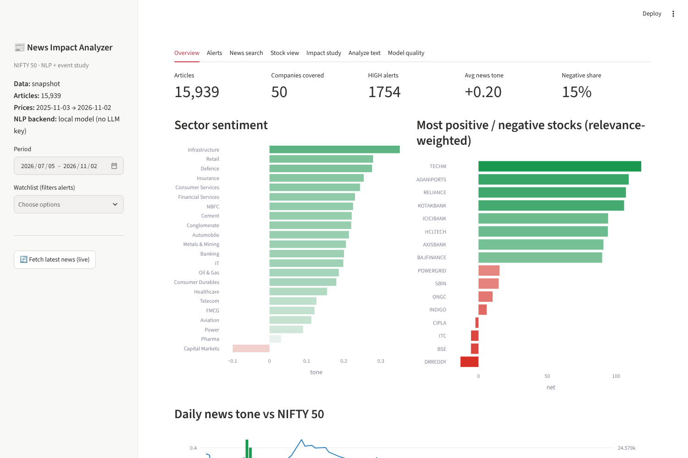
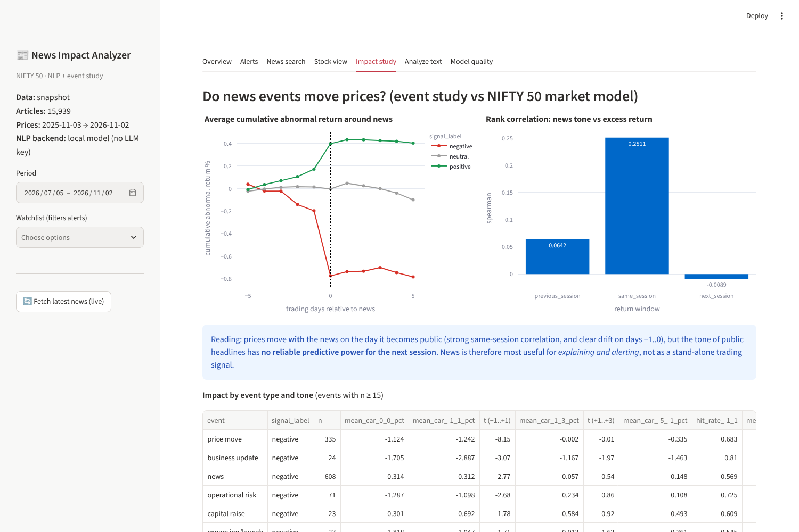
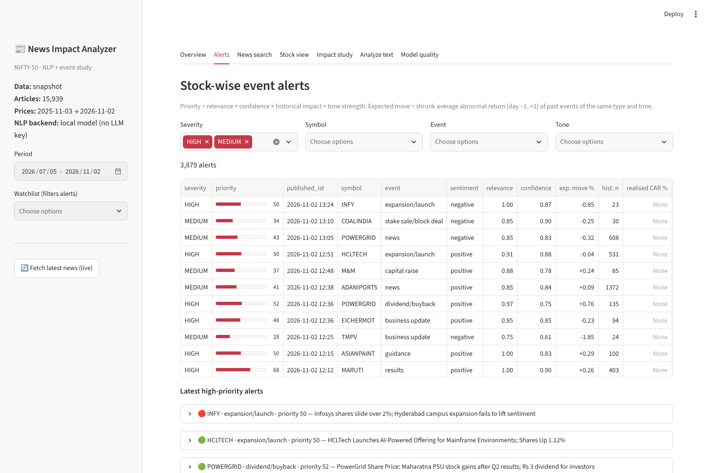
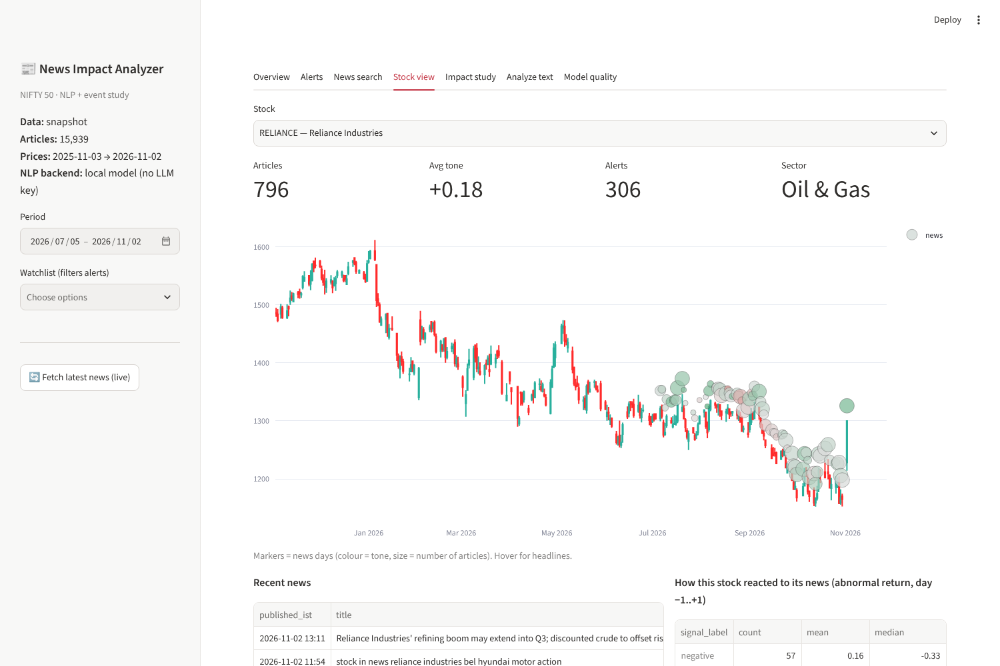

# AI-Based News Sentiment & Stock Impact Analyzer

Proof of concept for **Arihant Capital – Project 4**. It reads Indian market news and corporate
announcements, works out **which NIFTY 50 companies and sectors** each item is about, classifies
**sentiment** (positive / neutral / negative, per company), extracts **financial events** (earnings
surprises, M&A, management changes, orders, regulatory actions …), measures **how similar news moved
prices in the past** (event study against NIFTY 50), and turns that into **stock-wise alerts with
relevance, confidence and expected-impact scores**, all in a **searchable dashboard** and a **REST API**.

It runs **fully offline** out of the box (bundled real data and a bundled model) and gets better when
you add internet (live RSS / NSE / yfinance) and an LLM key (Claude, GPT or Gemini).

```
 RSS / NSE filings / CSV ──► clean + dedupe ──► entities & sectors ──► events ──► sentiment (LLM | FinBERT | local)
                                                                                        │
 yfinance / snapshot prices ──► trading-day mapping ──► event study (market model, CAR) ◄┘
                                                              │
                                       impact table ──► alerts (relevance × confidence × expected move)
                                                              │
                                          SQLite + FTS5 ──► Streamlit dashboard · FastAPI
```

| Overview | Impact study |
|---|---|
|  |  |
| **Alerts** | **Stock view** |
|  |  |

## Quick start

```bash
# Windows: double-click run.bat     (macOS/Linux: ./run.sh)
python -m venv .venv && .venv\Scripts\activate        # source .venv/bin/activate on macOS/Linux
pip install -r requirements.txt
python -m newsimpact.cli build                         # ~1 min: 16k headlines -> NLP -> event study -> alerts
streamlit run dashboard/app.py                         # dashboard on http://localhost:8501
uvicorn api.main:app                                   # API on http://127.0.0.1:8000/docs
pytest -q                                              # 26 tests
```

Live data (needs internet): `python -m newsimpact.cli fetch --days 7` (or the **Fetch latest news** button in the
dashboard). Optional LLM: copy `.env.example` to `.env` and paste one API key.

Other commands:

```bash
python -m newsimpact.cli analyze "Infosys beats estimates, raises FY27 guidance"   # one text -> JSON
python -m newsimpact.cli alerts --top 20 [--symbol TCS]
python -m newsimpact.cli ingest my_news.csv          # your own file: title, published[, source, url]
python -m newsimpact.cli train                       # retrain + re-evaluate the local sentiment model
```

## Free hosting (Streamlit Community Cloud)

1. Push this folder to a public GitHub repository.
2. Go to https://share.streamlit.io, sign in with GitHub, click **Create app**, pick the repo, branch `main`, main file `dashboard/app.py`, Python 3.11 or 3.12.
3. Optional: under **Advanced settings → Secrets**, add `ANTHROPIC_API_KEY = "..."` (or an OpenAI / Gemini key) to switch on the LLM layer.
On first start the app builds its database from the bundled snapshot (about a minute). After that the **Fetch latest news** button pulls live news, since the cloud host has internet.

## How requirements map to the build

| # | Requirement | Where / how |
|---|---|---|
| 1 | NLP pipeline for news & announcements | `ingest/news.py` (Google News RSS per company, ET / Moneycontrol / Mint / BS feeds, NSE corporate announcements, CSV/JSON files, bundled snapshot) → `pipeline.clean` (dedupe, junk filter) → `nlp/analyzer.py` |
| 2 | Companies, sectors, events | `nlp/entities.py`: alias dictionary for the 50 stocks with case-sensitive tickers, regex aliases for ambiguous names (BSE the company vs. the exchange) and a **blocklist of look-alikes** (HDFC Securities, Reliance Power, Axis MF, Indigo Paints …), longest-match wins. Sector from company + keyword rules. Market-wide/macro flag. |
| 3 | Sentiment | `nlp/sentiment.py`: backends **LLM → FinBERT → local TF-IDF+LR → lexicon**, automatic fallback. **Target-aware**: in "Kotak profit falls; Tech Mahindra jumps", each company gets its own clause's tone. Sentiment blended with the event's prior into a `signal`. |
| 4 | Significant events | `nlp/events.py`: 17-type taxonomy, ~50 tuned regex rules with direction and confidence (earnings beat/miss, M&A, management change, orders, regulatory action vs. approval, broker rating, capital raise, block deals, guidance, monthly sales, operational risk, macro, price commentary). |
| 5 | Historical news → price relationship | `impact/event_study.py`: market-model event study (β fitted on days −120…−11), CAR windows, t-stats, hit rates, abnormal volume, leakage window (−5…−1), drift (+1…+5), next-day correlation and a long/short back-test. |
| 6 | Alerts with relevance & confidence | `impact/alerts.py`: near-duplicate clustering, relevance, confidence, **expected move from history (empirical-Bayes shrunk)**, priority 0–100, HIGH/MEDIUM/LOW, plain-English reason. Checked **walk-forward**. |
| 7 | Searchable dashboard | `dashboard/app.py` (Streamlit): Overview, Alerts, full-text News search (SQLite FTS5), Stock view (candles + news markers), Impact study, Analyze-any-text, Model quality. REST API in `api/main.py`. |

## Results on real data (NIFTY 50, 5 Jul – 2 Nov 2026)

Data: 15,939 unique headlines (Google News RSS, 1,000+ outlets) and daily prices for the 50 stocks and NIFTY 50.
Full numbers are in `reports/` and the dashboard.

**Sentiment model** (held-out test sets, `reports/sentiment_eval.json`)

| Test set | n | Accuracy | Macro-F1 | Majority baseline |
|---|---|---|---|---|
| Indian headlines (SEntFiN) | 1,876 | **84.3%** | 0.843 | 35.9% |
| Financial PhraseBank | 452 | 89.4% | 0.874 | 60.6% |

On the hard case of headlines naming several companies with *different* tones, target-clause scoring lifts
accuracy from 49.4% to 54.0%. This is the gap the LLM backend is meant to close.

**Entity linking:** the company a headline was collected for is found in 81% of headlines. Most of the
other 19% do not name it at all (search noise), and those are deliberately not force-tagged.

**Do prices react?** (8,159 stock-day events, abnormal returns vs NIFTY 50)

| Tone | n | AR day 0 | CAR −1…+1 | t | Drift +1…+3 |
|---|---|---|---|---|---|
| Positive | 3,974 | +0.23% | **+0.32%** | 6.9 | +0.03% (t 0.7) |
| Negative | 1,571 | −0.58% | **−0.62%** | −8.1 | +0.05% (t 0.8) |
| Neutral | 2,614 | −0.02% | +0.02% | 0.3 | 0.0% |

Strongest event types (|t| ≥ 2, n ≥ 20): order wins **+1.30%** (t 3.8, 72% hit rate), earnings beats **+1.14%**,
dividends/buybacks **+0.82%**, broker upgrades **+0.57%**, negative business updates (weak monthly sales)
**−2.89%** (81% hit rate), operational risk (fire, outage, strike) **−1.10%**. Negative news moves prices about
twice as much as positive news.

**Can you trade it?** No, not on its own. News tone has a 0.25 rank correlation with the **same** session's excess return
(p ≈ 1e-43), but **−0.01** with the **next** session (p = 0.63). A long-positive / short-negative back-test
earns ~1 bp/day gross (t = 0.2) and loses money after 10 bps costs. The market prices public headlines within
the day. The value is in **fast, ranked alerting and explanation**, not prediction.

**Do the alerts rank the right things?** Walk-forward test: impact table learned on news before 11 Sep 2026,
alerts scored after it (2,575 alerts):

| Severity | n | Mean realised move (abs CAR −1…+1) | Direction hit rate |
|---|---|---|---|
| HIGH | 565 | **3.64%** | **60.2%** |
| MEDIUM | 987 | 2.50% | 57.5% |
| LOW | 1,023 | 2.08% | 55.0% |

Priority vs. realised move: Spearman 0.18 (p ≈ 6e-20). The ranking is monotonic, out of sample.

## Robustness decisions

- **Always works offline:** bundled real snapshot plus a bundled model. Each live source is fetched on its own with timeouts. If all live sources fail, the run falls back to the snapshot and says so. If the pickled model will not load (e.g. a different scikit-learn version), it **retrains itself** from the bundled data in seconds.
- **LLM is optional and contained:** provider chosen from whichever key is set (Anthropic / OpenAI / Gemini), plain HTTPS (no SDK lock-in), batching (15 headlines per call), SQLite **response cache** (re-runs cost nothing), retries with backoff, a **schema validator** that drops unknown tickers or event types and clamps numbers, a **cost cap** (`NIA_LLM_MAX_ITEMS`), and per-item fallback to the local models. Tested with a mocked provider.
- **Avoids false company tags:** blocklist of look-alike entities, case-sensitive tickers, longest match, link confidence per alias, round-up ("stocks to watch") penalty.
- **Timestamps:** IST conversion, news after the 15:30 close maps to the next session, weekends and holidays map through the NIFTY trading calendar, and date-only RSS stamps are flagged. CAR[−1,+1] is the headline window for that reason.
- **Statistics:** articles collapsed to unique stock-day events (20 articles on one result count once). Daily returns above 25% are treated as data errors or corporate actions. Small event buckets are shrunk toward the tone mean, so 3 lucky events cannot produce an extreme alert.
- **Duplicates:** exact-title dedupe, then near-duplicate clustering (token Jaccard ≥ 0.5 within 72h per company). Multi-outlet coverage raises confidence instead of creating extra alerts.
- **Search:** SQLite FTS5 with safe query escaping, and LIKE fallback where FTS5 is missing.

## Project layout

```
newsimpact/            core package
  ingest/news.py       live RSS / NSE / file / snapshot loaders
  ingest/prices.py     yfinance + cache + snapshot fallback
  nlp/entities.py      company & sector recognition (data_universe.csv, data_blocklist.txt)
  nlp/events.py        event taxonomy & rules
  nlp/sentiment.py     sentiment backends + target-aware scoring
  nlp/llm.py           optional LLM enrichment (cache, retries, validation)
  nlp/analyzer.py      combines everything per article
  nlp/train.py         trains / evaluates the local model
  impact/event_study.py, impact/alerts.py
  store.py             SQLite + FTS5
  pipeline.py, cli.py, service.py
dashboard/app.py       Streamlit UI
api/main.py            FastAPI (/analyze, /news, /alerts, /stocks/{symbol}, /impact, /universe, /health)
data/snapshot/         bundled headlines + prices        data/training/  sentiment training data
models/                bundled sentiment model           reports/        evaluation outputs
tests/                 26 unit / integration tests
```

## Data sources & licences

- Headlines and prices snapshot: recorded from public Google News RSS and the Yahoo chart API by the open-source NiftyLens project (MIT). Rebuild it with `scripts/build_snapshot.py`.
- SEntFiN 1.0 (Sinha et al., 2022, MIT): Indian financial headlines with entity-level sentiment.
- Financial PhraseBank (Malo et al., 2014, CC BY-NC-SA 3.0): non-commercial use only. For commercial use, retrain on SEntFiN alone.

## Limitations & next steps

- The universe is NIFTY 50. Extending it means adding rows to `data_universe.csv`, and the NSE equity list can generate aliases automatically.
- Headline-level only. Article bodies or PDF filings could go through the same analyzer, with the LLM summarising long announcements.
- About 4 months of overlapping news and prices, so several event buckets are small. Shrinkage handles this, but more history would tighten the estimates.
- Intraday prices would remove the timestamp ambiguity and allow minute-level impact measurement.
- Next for Arihant Plus: per-user watchlist alerts (push or WhatsApp), the API wired into the app's stock pages, and the LLM backend enabled for higher entity-level accuracy.

*Not investment advice.*
